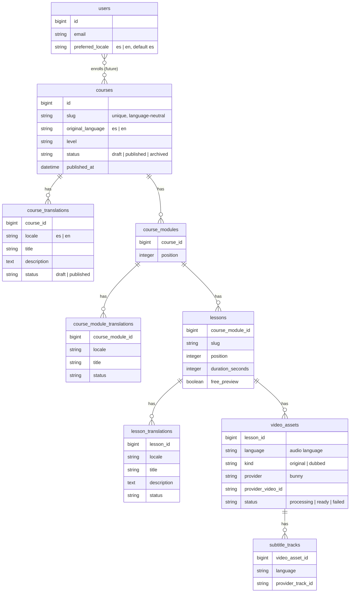

# Course content model (proposal)

> Status: **documented, not implemented.** No business models exist yet. This is the
> agreed direction for when course features are built.

## Goals

- Course content can exist in Spanish, English or both. Missing translations are normal.
- The interface language and the content language are independent.
- **Never invent translations.** If a lesson has no English text, the API says so and the
  client shows the Spanish version labelled as Spanish (or "not available in English").
- Available languages are derived from data that exists, not from flags that can drift.
- Admins can see at a glance what is missing.

## Normalized translation tables

Language-neutral data lives on the base table; translatable text lives in one row per
locale in a `*_translations` table. (A gem such as Mobility with the table backend can
implement this; the choice is made at implementation time.)



Constraints:

- Unique `(course_id, locale)` (and equivalents); `locale` constrained to `es`/`en`
  with a check constraint.
- A translation is only "available" when its `status` is `published`; drafts are never
  returned to students.
- `courses.original_language` must have a published translation before the course can
  be published.
- Unique `(lesson_id, language, kind)` on `video_assets`; unique
  `(video_asset_id, language)` on `subtitle_tracks`.

## Available languages

Computed, not stored:

- **Text:** locales with a published `course_translations` row.
- **Audio:** distinct `video_assets.language` with `status = ready`.
- **Subtitles:** distinct `subtitle_tracks.language` for ready assets.

API responses expose this explicitly, for example:

```json
{
  "slug": "salsa-fundamentals",
  "original_language": "es",
  "content_locale": "es",
  "requested_locale": "en",
  "available_languages": { "text": ["es"], "audio": ["es"], "subtitles": ["es", "en"] },
  "title": "Fundamentos de salsa"
}
```

`content_locale` is the language of the returned text. When the requested locale is
missing, the API returns the original-language text and says so (`content_locale` ≠
`requested_locale`); clients show the "available languages" badges
(`common.contentLanguages.*`) and a notice. Rails I18n fallbacks are not used for content.

## Admin (ActiveAdmin)

- Course, module and lesson forms show **es / en tabs**, one per translation row.
- Index pages show a **"Missing translations"** column (e.g. `en: title, description`)
  and a filter "missing translation in: es | en".
- Dashboard panel: counts of published content missing each language (a placeholder
  panel exists today in `app/admin/dashboard.rb`).
- Publishing is per translation, so Spanish can go live before English.

## Users

- `users.preferred_locale` (`es` default): interface language for emails and push
  notifications, and the default content language request.
- Optional later: `preferred_content_locales` to filter the catalog.
