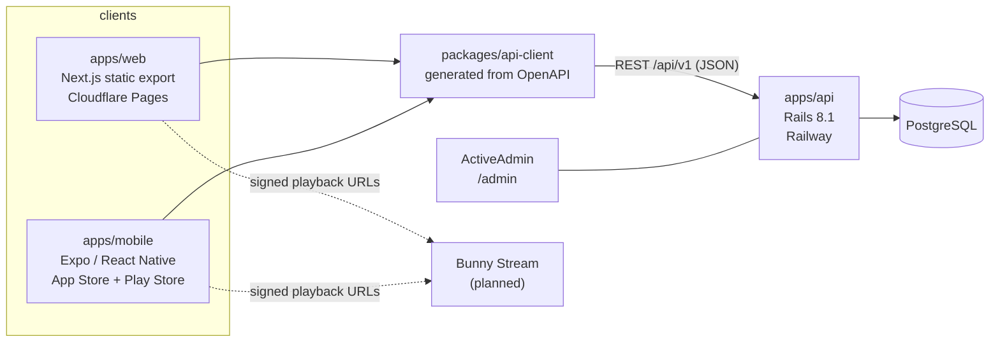

# Architecture overview

Top Dance Academy is a bilingual (Spanish default, English) online dance academy.
This repository is a pnpm + Turborepo monorepo with three independently deployable
apps and one shared package.

## Apps

| Path | Role | Runtime / hosting |
| --- | --- | --- |
| `apps/web` | Public site and student area | Static files on Cloudflare Pages |
| `apps/api` | Business logic, auth, authorization, admin | Rails on Railway + PostgreSQL |
| `apps/mobile` | Student app | Expo (EAS Build) |
| `packages/api-client` | Typed REST client | Bundled into web and mobile |

## Key decisions

- **Rails owns all business rules.** Authentication (Devise), authorization (Pundit),
  validation and data access live in `apps/api`. The web and mobile apps are clients;
  they never decide what a user may see.
- **The web app is a static export** (`output: "export"`). There is no Node server, so
  there is no middleware, no server-side cookies/headers, and no Server Actions. Pages
  are pre-rendered per locale and personalised data is fetched from the API in the
  browser with TanStack Query. Dynamic course/lesson URLs are served by a client
  "shell" page via Cloudflare `_redirects` rewrites generated at build time
  (`apps/web/scripts/post-export.mjs`).
- **Admin is ActiveAdmin**, served by Rails at `/admin`. There is no custom Next.js admin.
- **Background jobs, cache and Action Cable** use Solid Queue / Solid Cache / Solid Cable
  (database-backed, no Redis).
- **The contract between clients and API is OpenAPI.** rswag request specs generate
  `apps/api/swagger/v1/openapi.yaml`; `openapi-typescript` turns it into types that
  `packages/api-client` exposes. See [`docs/api`](../api/README.md).
- **UI code is not shared between web and mobile.** Web uses shadcn/ui (Radix + Tailwind);
  mobile uses React Native primitives. They share the design tokens (by value, verified
  by tests), translation keys and the API client.

## Request flow

1. The client sends `Accept-Language: es|en` (the interface language) with each request.
2. `Api::V1::BaseController` resolves the locale (`?locale` → `Accept-Language` → `es`),
   sets `Content-Language`, and localizes error messages.
3. Errors use a single JSON shape: `{ "error": { "code": "not_found", "message": "…" } }`.

## Internationalization

See [i18n.md](i18n.md). Interface translation (UI strings) and course content
translation (database) are separate concerns; see [content-model.md](content-model.md).

## Environments and deployment

| | Web | API | Mobile |
| --- | --- | --- | --- |
| Local | `pnpm dev:web` → http://localhost:3000 | `pnpm dev:api` → http://localhost:3001 | `pnpm dev:mobile` (Metro on :8081) |
| Production | Cloudflare Pages (`apps/web/out`) | Railway (Dockerfile in `apps/api`) | EAS Build / Submit |

Production domains assumed in config: `topdance.academy` (web) and
`api.topdance.academy` (API). Because the web app and the API share the parent domain
`topdance.academy`, browser requests are *same-site*, which the cookie-based web
authentication relies on (see [authentication.md](authentication.md)).

See [integrations.md](integrations.md) for third-party services.
